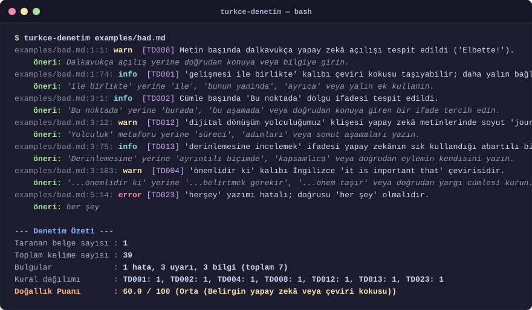

# turkce-denetim

> Türkçe metinlerdeki yapay zekâ kokusunu, çeviri kalıplarını ve yazım sorunlarını bulan kural tabanlı yazı denetleyicisi (linter) ve komut satırı aracı.

[](https://github.com/YusufBeratZengin/turkce-denetim/actions/workflows/ci.yml)
[](https://pypi.org/project/turkce-denetim/)
[](https://pypi.org/project/turkce-denetim/)
[](LICENSE)

[English Documentation (README.md)](README.md)

---

<p align="center">
  
</p>

---

## Neden turkce-denetim?

- **Sıfır Dış Bağımlılık ve Deterministik Çalışma**: Yalnızca Python standart kütüphanesini kullanır (Python >= 3.10); API anahtarı, bulut faturası, ağ gecikmesi veya yapay zekâ model sapmaları olmadan her seferinde birebir tutarlı ve anında sonuç üretir.
- **Türkçe Morfolojisine ve Dilbilgisine Özel**: `İ/i` ve `I/ı` dönüşümlerini işletim sisteminden bağımsız doğru yapar, gövde budayıcı (stemmer) ile yakın kök tekrarlarını yakalar; İngilizce çeviri kokularını ("sahip olmak", "...ile birlikte", "...noktasında") ve üretken dil modellerinin basmakalıplarını ("Elbette!", "...dünyasında", "yolculuk") hassas kurallarla süzgeçten geçirir.
- **Geliştirici Dostu ve CI Entegrasyonuna Hazır**: Renkli terminal arayüzü, betikler için JSON ve GitHub Code Scanning ile tam uyumlu SARIF 2.1.0 çıktısı üretir; pre-commit kancalarıyla geliştirme akışınıza zahmetsizce eklenir.

---

## Hızlı Başlangıç

Pip ile kurup Markdown veya metin dosyalarınızı hemen denetleyin:

```bash
# Paketi yükleyin
pip install turkce-denetim

# Dosya veya dizini denetleyin
turkce-denetim metin.md
```

---

## Önemli Uyarı

> **Bu araç bir metnin yapay zekâ tarafından yazıldığını kesin olarak kanıtlamaz.**
> Yalnızca yapay zekâ metinlerinde ve İngilizceden birebir çevrilmiş yazılarda sık görülen basmakalıpları, çeviri kokusunu ve yazım hatalarını gösterir. İnsanın yazdığı bir metin de arada bu kurallara takılabilir; yapay zekâ metni de bu kalıplardan temizlenmiş olabilir. Doğallık puanı kesin bir hüküm vermez, yazarın işini kolaylaştıran bir göstergedir.

---

## Öne Çıkan Özellikler

- **Bağımlılık yok**: Yalnızca Python standart kütüphanesini kullanır (Python 3.10 ve üstü).
- **25 kural**: Çeviri kalıpları, yapay zekâ basmakalıpları, okunabilirlik ve yazım kuralları.
- **Doğru büyük/küçük harf**: `İ/i` ve `I/ı` ayrımını Türkçe kurallarına göre eksiksiz yapar.
- **Ek budayıcı (stemmer)**: Aynı kökten gelen sözcüklerin bir cümlede fazla tekrarlanmasını, dış NLP paketi kullanmadan yakalar.
- **Markdown bilir**: Kod bloklarını (```` ``` ```` ve `~~~`), HTML yorumlarını (`<!-- ... -->`) ve satır içi kodu (`` `...` ``) boşlukla maskeler; satır ve sütun numaraları tam korunur.
- **Çoklu çıktı biçimi**: Renkli terminal çıktısı, JSON (`--format json`) ve GitHub Code Scanning için SARIF 2.1.0 (`--format sarif`).
- **Doğallık puanı (0-100)**: Bulguların yüz sözcüğe düşen ağırlığından hesaplanır; formül aşağıda şeffaf biçimde açıklanmıştır.
- **Esnek yapılandırma**: `pyproject.toml` içindeki `[tool.turkce-denetim]` bölümünden ya da `--disable` ve `--min-severity` bayraklarından yönetilebilir.

---

## Kullanım

### Komut Satırı Arayüzü (CLI)

```bash
# Bulunduğun dizindeki tüm .md ve .txt dosyalarını denetle
turkce-denetim

# Belirli bir dosya ya da dizini tara
turkce-denetim metin.md
turkce-denetim docs/

# Komut PATH'te değilse aynısı modül olarak da çalışır
python -m turkce_denetim metin.md

# Metni standart girdiden (stdin) oku
cat taslak.txt | turkce-denetim -

# JSON çıktısı al
turkce-denetim metin.md --format json

# GitHub Code Scanning için SARIF raporu üret
turkce-denetim docs/ --format sarif > sonuclar.sarif

# Belirli kuralları devre dışı bırak
turkce-denetim metin.md --disable TD001,TD005

# Yalnızca warn ve error düzeyindeki bulguları göster
turkce-denetim metin.md --min-severity warn

# Sadece sayısal doğallık puanını yazdır
turkce-denetim metin.md --score-only

# Mevcut tüm kuralları listele
turkce-denetim --list-rules
```

### CLI Seçenekleri

| Seçenek | Tür | Varsayılan | Açıklama |
|---|---|---|---|
| `targets` | Konumsal | `.` | Denetlenecek dosya ya da dizin; stdin için `-`. |
| `-f, --format` | Seçenek | `text` | Çıktı biçimi: `text`, `json`, `sarif`. |
| `-d, --disable` | Metin | Yok | Kapatılacak kural kimlikleri, virgülle ayrılır (örn: `TD001,TD003`). |
| `-s, --min-severity`| Seçenek | `info` | Gösterilecek en düşük önem: `info`, `warn`, `error`. |
| `-c, --config` | Yol | Yok | Kendi TOML yapılandırma dosyanızın yolu. |
| `--no-color` | Bayrak | False | Terminal renklerini kapatır. |
| `--score-only` | Bayrak | False | Yalnızca sayısal doğallık puanını yazar. |
| `--list-rules` | Bayrak | False | Mevcut tüm kuralları listeler (kimlik, ad, önem ve açıklama). |
| `-v, --version` | Bayrak | | Program sürümünü gösterir. |

### Çıkış Kodları (Exit Codes)

| Kod | Anlamı |
|---|---|
| `0` | Başarılı: error düzeyinde bulgu yok (metin temiz ya da yalnızca info/warn önerileri var). |
| `1` | Hata bulundu: bir veya daha fazla `error` önem düzeyinde bulgu (yazım ve imla kuralları). |
| `2` | Kullanım, yapılandırma veya girdi/çıktı hatası: geçersiz parametre ya da hatalı TOML. |

### Canlı Demo Çıktısı

```bash
$ turkce-denetim examples/bad.md --no-color
examples/bad.md:1:1: warn  [TD008] Metin başında dalkavukça yapay zekâ açılışı tespit edildi ('Elbette!').
    öneri: Dalkavukça açılış yerine doğrudan konuya veya bilgiye girin.
examples/bad.md:1:74: info  [TD001] 'gelişmesi ile birlikte' kalıbı çeviri kokusu taşıyabilir; daha yalın bağlaçlar tercih edilebilir.
    öneri: 'ile birlikte' yerine 'ile', 'bunun yanında', 'ayrıca' veya yalın ek kullanın.
examples/bad.md:3:1: info  [TD002] Cümle başında 'Bu noktada' dolgu ifadesi tespit edildi.
    öneri: 'Bu noktada' yerine 'burada', 'bu aşamada' veya doğrudan konuya giren bir ifade tercih edin.
examples/bad.md:3:12: warn  [TD012] 'dijital dönüşüm yolculuğumuz' klişesi yapay zekâ metinlerinde soyut 'journey' çevirisidir.
    öneri: 'Yolculuk' metaforu yerine 'süreci', 'adımları' veya somut aşamaları yazın.
examples/bad.md:3:75: info  [TD013] 'derinlemesine incelemek' ifadesi yapay zekânın sık kullandığı abartılı bir dolgudur.
    öneri: 'Derinlemesine' yerine 'ayrıntılı biçimde', 'kapsamlıca' veya doğrudan eylemin kendisini yazın.
examples/bad.md:3:103: warn  [TD004] 'önemlidir ki' kalıbı İngilizce 'it is important that' çevirisidir.
    öneri: '...önemlidir ki' yerine '...belirtmek gerekir', '...önem taşır' veya doğrudan yargı cümlesi kurun.
examples/bad.md:5:14: error [TD023] 'herşey' yazımı hatalı; doğrusu 'her şey' olmalıdır.
    öneri: her şey

--- Denetim Özeti ---
Taranan belge sayısı : 1
Toplam kelime sayısı : 39
Bulgular             : 1 hata, 3 uyarı, 3 bilgi (toplam 7)
Kural dağılımı       : TD001: 1, TD002: 1, TD004: 1, TD008: 1, TD012: 1, TD013: 1, TD023: 1
Doğallık Puanı       : 60.0 / 100 (Orta (Belirgin yapay zekâ veya çeviri kokusu))
```

---

## Python Kütüphanesi Olarak Kullanım

`turkce-denetim`'i doğrudan kendi Python betiklerinizde ve iş akışlarınızda kullanabilirsiniz:

```python
from turkce_denetim import Config, analyze_text

metin = "Bu noktada konuyu derinlemesine incelemek çok önemlidir ki sonuç alalım."
config = Config(min_severity="warn")

sonuc = analyze_text(metin, config)

print(f"Sözcük sayısı : {sonuc.word_count}")
print(f"Doğallık puanı: {sonuc.naturalness_score} / 100")

for bulgu in sonuc.findings:
    print(f"Satır {bulgu.line}:{bulgu.column} [{bulgu.rule_id}] {bulgu.message}")
    if bulgu.suggestion:
        print(f"  Öneri: {bulgu.suggestion}")
```

---

## Pre-commit Entegrasyonu

Projenizin `.pre-commit-config.yaml` dosyasına ekleyerek her commit öncesinde Markdown ve metin dosyalarını otomatik denetleyebilirsiniz:

```yaml
repos:
  - repo: https://github.com/YusufBeratZengin/turkce-denetim
    rev: v0.1.0
    hooks:
      - id: turkce-denetim
```

---

## GitHub Actions CI Entegrasyonu

Pull request'lerde metinleri denetlemek ve sonuçları GitHub Code Scanning (SARIF) sekmesinde incelemek için:

```yaml
name: Text Quality

on:
  pull_request:
    branches: [main]

jobs:
  lint-text:
    runs-on: ubuntu-latest
    permissions:
      security-events: write
      contents: read

    steps:
      - uses: actions/checkout@v4

      - uses: actions/setup-python@v5
        with:
          python-version: "3.12"

      - name: turkce-denetim kur
        run: pip install turkce-denetim

      - name: Metinleri denetle ve SARIF üret
        run: turkce-denetim . --format sarif > sonuclar.sarif
        continue-on-error: true

      - name: SARIF raporunu yükle
        uses: github/codeql-action/upload-sarif@v3
        with:
          sarif_file: sonuclar.sarif
```

---

## Kural Kataloğu

Linter, 4 temel kategoride 25 kural uygular:

### 1. Çeviri Kalıpları (Translation Patterns)

| Kimlik | Kural Adı | Önem | Sorunlu Örnek | Öneri |
|---|---|---|---|---|
| `TD001` | `ile-birlikte-asiri` | `info` | "Teknolojinin gelişmesi ile birlikte..." | Yalın ek ("gelişmesiyle") veya doğrudan bağlaç kullanın. |
| `TD002` | `bu-noktada` | `info` | "Bu noktada dikkat etmeliyiz." | "Burada", "bu aşamada" yazın veya doğrudan konuya girin. |
| `TD003` | `gunun-sonunda` | `warn` | "Günün sonunda, karar verildi." | "At the end of the day" çevirisi. "Sonuçta" veya "nihayetinde" kullanın. Gün sonu zaman ifadesi ("Günün sonunda eve döndük") uyarılmaz. |
| `TD004` | `onemlidir-ki` | `warn` | "Şunu belirtmek önemlidir ki bu bir hatadır." | "It is important that" çevirisi. "...belirtmek gerekir" veya "...önem taşır" tercih edin. |
| `TD005` | `konusunda-yigilmasi` | `warn` | "Veri güvenliği konusunda ve mimari konusundaki..." | "...konusunda" yığılması yerine "-e dair" veya doğrudan ismin hâl eklerini kullanın. |
| `TD006` | `sahip-olmak` | `warn` | "Bu cihaz yüksek bir hıza sahiptir." | "To have" çevirisi. İyelik eki ("cihazın hızı yüksektir") veya "vardır / bulunur" tercih edin. |
| `TD007` | `edilgen-yigilmasi` | `warn` | "Planlar yapıldı, bütçe onaylandı ve görevler dağıtıldı." | Bir cümlede 3+ edilgen fiil. Etken çatılı fiillerle yeniden yazın. |

### 2. Yapay Zekâ Kalıpları (AI Patterns)

| Kimlik | Kural Adı | Önem | Sorunlu Örnek | Öneri |
|---|---|---|---|---|
| `TD008` | `elbette-acilis` | `warn` | "Elbette! Size yardımcı olabilirim." | Dalkavukça açılış. Doğrudan konuya veya yanıta girin. |
| `TD009` | `harika-soru` | `warn` | "Harika bir soru sordunuz." | Sohbet robotu övgüsü. Cümleyi kaldırıp doğrudan yanıt verin. |
| `TD010` | `sonuc-olarak-kapanis` | `info` | "Sonuç olarak, bu adımlar başarımızı artıracaktır." | Klişe kapanış geçişi. Kapanış paragrafına ana düşünceyle başlayın. |
| `TD011` | `dunyasi-metaforu` | `info` | "Yapay zekâ dünyasında her gün yeni bir adım..." | "In the world of..." çevirisi. Doğrudan bulunma hâli kullanın: "yapay zekâda", "yazılımda". |
| `TD012` | `yolculuk-metaforu` | `warn` | "Dijital dönüşüm yolculuğumuz başladı." | Süreçler için basmakalıp metafor. "Süreci", "adımları" veya "deneyimi" yazın. |
| `TD013` | `derinlemesine` | `info` | "Bu konuyu derinlemesine inceleyelim." | Abartılı yapay zekâ zarfı. "Ayrıntılı biçimde" veya doğrudan fiili kullanın. |
| `TD014` | `kapsamli-sekilde` | `info` | "Raporu kapsamlı bir şekilde hazırladık." | Dolgu ifade. "Kapsamlıca" veya doğrudan fiili tercih edin. |
| `TD015` | `uclu-sifat-dizisi` | `info` | "Hızlı, esnek ve güvenli bir çözüm." | Basmakalıp üçlü sıfat zinciri. İddiaları paragrafa veya bağımsız ifadelere yayın. |
| `TD016` | `paragraf-acilis-tekrari` | `warn` | Paragraf 1 ve 2'nin ikisinin de "Ayrıca..." ile başlaması. | Paragraf geçişlerini çeşitlendirin. |

### 3. Okunabilirlik ve Yapı (Readability)

| Kimlik | Kural Adı | Önem | Sorunlu Örnek | Öneri |
|---|---|---|---|---|
| `TD017` | `cumle-uzunlugu` | `warn` | 35 sözcüğü aşan uzun cümle. | İki veya daha fazla bağımsız cümleye bölün. |
| `TD018` | `paragraf-uzunlugu` | `info` | 120 sözcüğü aşan uzun paragraf. | Alt başlıklara veya ayrı paragraflara ayırın. |
| `TD019` | `yakin-kelime-tekrari` | `warn` | Aynı cümlenin içinde aynı kökün (örn: "yaz-") 3+ kez geçmesi. | Zamir, eşanlamlı sözcük kullanın veya cümleyi sadeleştirin. |
| `TD020` | `virgul-zinciri` | `info` | Tek bir cümlede 5+ virgül bulunması. | Cümleyi bölün veya noktalı virgül / madde imi kullanın. |
| `TD025` | `veya-baglac-tekrari` | `info` | Tek cümlede 3+ "ve / veya" bağlacı. | Virgüllü liste yapın ya da cümleyi bölün. |

### 4. Yazım ve Tipografi (Spelling & Typography)

| Kimlik | Kural Adı | Önem | Sorunlu Örnek | Öneri |
|---|---|---|---|---|
| `TD021` | `de-da-baglaci` | `error` | "Gittide söylemedi" / "Ev de kaldım" | Bağlaç olan "de/da" ayrı; bulunma hâli eki bitişik yazılır. |
| `TD022` | `ki-baglaci` | `error` | "Gördümki her şey yolunda" / "Demekki" | Çekimli fiillerden sonra gelen "ki" bağlacı ayrı yazılır. |
| `TD023` | `bilesik-ayri-yazim` | `error` | "herşey", "hiçbirşey", "bir çok", "farketmek" | TDK yazım kuralları ("her şey", "birçok", "fark etmek"). |
| `TD024` | `tirnak-tutarsizligi` | `info` | Düz tırnak (`"`) ile tipografik tırnakların (`“”`) karışık kullanımı. | Belge genelinde tutarlı bir tırnak işareti stili benimseyin. |

---

## Doğallık Puanı Formülü

Doğallık Puanı, yüz sözcük başına düşen bulgu yoğunluğunu ölçen sınırlı bir ölçüttür ($0.0 - 100.0$).

1. Her bulgu önem derecesine göre ceza ağırlığı alır:
   - **Hata (Error)**: $8.0$ ceza puanı
   - **Uyarı (Warning)**: $3.0$ ceza puanı
   - **Bilgi (Info)**: $1.0$ ceza puanı
2. Toplam ceza, en az 50 sözcük tabanı gözetilerek toplam sözcük sayısı $W$ üzerinden normalize edilir:
   $$\text{Ceza} = \frac{\sum \text{Ağırlıklar} \times 100}{\max(W, 50)}$$
3. Nihai puan sınırlandırılır ve bir ondalık basamağa yuvarlanır:
   $$\text{Puan} = \max(0.0, \min(100.0, 100.0 - \text{Ceza}))$$

### Puan Değerlendirme Tablosu

| Aralık | Değerlendirme | Tipik Durum |
|---|---|---|
| **90.0 – 100.0** | Yüksek Doğallık | Akıcı ve doğal Türkçe; kural bulgusu yok veya önemsiz düzeyde. |
| **75.0 – 89.9** | İyi | Açık ve anlaşılır metin; az sayıda üslup dolgusu barındırır. |
| **50.0 – 74.9** | Orta | Belirgin yapay zekâ veya çeviri kokusu. Düzeltme gerekir. |
| **0.0 – 49.9** | Düşük | Ağır çeviri kalıpları, tekrarlayan klişeler veya yazım hataları. |

---

## Yapılandırma

`turkce-denetim` aracını projenizin `pyproject.toml` dosyası altındaki `[tool.turkce-denetim]` bölümünden yapılandırabilirsiniz:

```toml
[tool.turkce-denetim]
# En düşük raporlama düzeyi ("info", "warn", "error")
min_severity = "info"

# Devre dışı bırakılacak kural kimlikleri
disable = ["TD001", "TD014"]

# Eşik değerleri
max_sentence_words = 35
max_paragraph_words = 120
max_commas_per_sentence = 5
max_passive_per_sentence = 3
min_word_repetition = 3
```

---

## SSS ve Sınırlar (FAQ)

### Düşük puan metnin yapay zekâ tarafından yazıldığını kanıtlar mı?
**Hayır.** `turkce-denetim` dil modellerinde ve makine çevirilerinde yaygın görülen üslup alışkanlıklarını, çeviri kalıplarını ve biçimsel tekrarları tespit eder. İnsan yazarlar da zaman zaman bu kalıpları kullanabilir; yapay zekâ metinleri de düzenlenerek 100 puan alabilir. Doğallık puanı yazara yol gösteren bir analiz aracıdır, bir telif damgası değildir.

### Tamamen çevrimdışı ve kapalı ağlarda çalışabilir mi?
**Evet.** `turkce-denetim` hiçbir harici bağımlılığa sahip değildir ve internet bağlantısı gerektirmez. Python 3.10 veya üzeri kurulu olan her ortamda yerel olarak güvenle çalışır.

### Hangi dosya biçimlerini destekler?
Markdown (`.md`) ve düz metin (`.txt`) dosyalarını işler. Markdown dosyalarında kod blokları (```` ``` ````, `~~~`), HTML yorumları (`<!-- ... -->`) ve satır içi kodlar (`` `...` ``) boşlukla maskelenir; böylece kod satırları yalancı pozitif üretmezken satır ve sütun numaraları tam olarak korunur.

### Türkçe noktalı ve noktasız I harfleri nasıl ele alınıyor?
Türkçede büyük `I` küçük `ı`'ya, büyük `İ` ise küçük `i`'ye dönüşür. Standart kütüphanedeki `lower()` fonksiyonları sistem diline göre bu kuralı bozabilir. `turkce-denetim`, işletim sistemi yerelinden bağımsız çalışan özel Türkçe harf dönüştürme algoritmalarına sahiptir.

---

## Katkıda Bulunma

Topluluk katkılarını memnuniyetle karşılıyoruz! Geliştirme ortamı kurulumu, test rehberi ve kod standartları için lütfen [CONTRIBUTING.md](CONTRIBUTING.md) dosyasını inceleyin.

```bash
# Depoyu klonlayın ve geliştirici ortamını hazırlayın
git clone https://github.com/YusufBeratZengin/turkce-denetim.git
cd turkce-denetim
python -m venv .venv
source .venv/bin/activate  # Windows: .\.venv\Scripts\activate
pip install -e ".[dev]"

# Testleri ve denetleyicileri çalıştırın
pytest
ruff check .
ruff format --check .
mypy src tests
```

---

## Lisans

Bu proje MIT Lisansı kapsamında lisanslanmıştır. Ayrıntılar için [LICENSE](LICENSE) dosyasına bakabilirsiniz.

Copyright (c) 2026 Yusuf Berat Zengin
